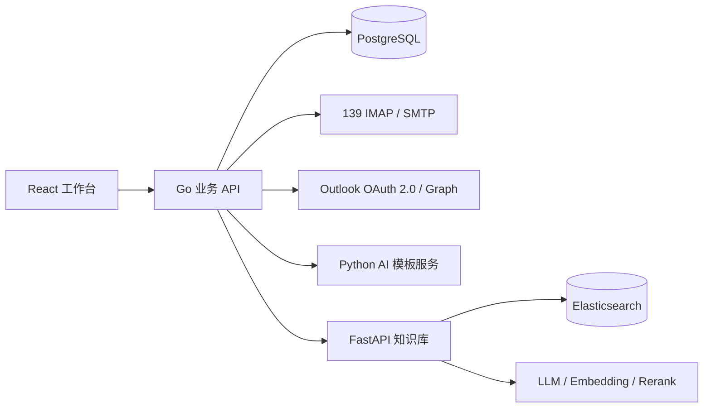

# 科技金融智能体协同管理平台

面向基金投资场景的业务协同项目，包含通讯管理、审批、AI 模板生成及独立企业知识库。采用单仓库管理代码，服务仍然独立运行，通过 HTTP API 连接。

## 目录与服务

```text
fintech-agent-platform/
├─ platform/
│  ├─ backend/       Go + Gin + GORM + PostgreSQL，业务 API
│  ├─ frontend/      React + TypeScript，业务工作台
│  ├─ ai/            Python，AI 模板生成服务
│  └─ deploy/        PostgreSQL、Redis、MinIO 的 Docker Compose
├─ knowledge/       FastAPI + Elasticsearch，企业知识库与管理界面
├─ scripts/         本地配置初始化
└─ docs/            架构、接入说明与验证记录
```

| 服务 | 默认本地地址 | 职责 |
| --- | --- | --- |
| 工作台 | http://localhost:3000 | 通讯管理、审批等业务入口 |
| Go API | http://localhost:8080 | 用户认证、业务接口、知识库代理 |
| AI 服务 | http://localhost:9100 | 邮件模板等模型调用 |
| 知识库 | http://localhost:8201 | 文档解析、入库、检索、问答、管理界面 |
| Elasticsearch | http://localhost:9202 | 知识库索引，仅绑定本机 |

基金、投资、会议等导航和基础骨架不代表所有业务均已完整实现。主要完成的业务代码见 `platform/backend/internal/module-communication`、`module-approval`、`module-knowledge`。

## 两个项目如何连接



Go 后端通过 `KNOWLEDGE_SERVICE_BASE_URL` 和服务端密钥调用知识库的 `/api/v1/retrieve`、`/api/v1/answer`。这两个接口在原项目中已经存在，本仓库进行代码归并与文档整理，不代表新增加了业务集成。细节见 [架构与边界](docs/architecture.md)。

## Windows 本地启动

需要 Go 1.25+、Node.js 20+、Python 3.10+、Docker Desktop。首次启动需联网下载依赖和镜像。下面的命令从仓库根目录执行。

### 1. 创建本地配置

```powershell
powershell -ExecutionPolicy Bypass -File scripts/init-env.ps1
```

脚本只创建缺失的 `.env`，不覆盖已有配置，并在首次初始化时生成 JWT 密钥及知识库共享密钥。然后按需要填写：

- `platform/ai/.env`：模型 API Key、模型名、服务地址。
- `knowledge/.env`：LLM、Embedding 及加密主密钥，重排配置可选。
- `platform/backend/.env`：Outlook 的应用注册信息及令牌加密密钥（使用 Outlook 时必填）。
- `platform/frontend/.env`：仅在需要独立的 AI 报告入口时填写服务端模型配置；不要使用 `VITE_` 变量存放密钥。

内置的数据库、MinIO、管理员等默认凭据只用于本地开发，部署前必须替换。没有模型密钥时不能验证真实 AI 生成或向量检索。

### 2. 启动基础设施和知识库

```powershell
docker compose -f platform/deploy/docker-compose.yml up -d
docker compose --project-directory knowledge --env-file knowledge/.env -f knowledge/docker-compose.yml up -d --build
```

原有部署使用固定容器名及端口。如果旧项目正在运行，请先停止对应服务，或自行调整复制版本的容器名和端口；不要让两套环境同时争用端口。本仓库不带原业务文档、数据库、邮箱数据和模型权重。扫描件 OCR 的离线模型需要另行准备，参见知识库解析代码与依赖说明。

### 3. 分别在三个终端启动应用

终端一：

```powershell
cd platform/backend
go run ./cmd/server
```

终端二：

```powershell
cd platform/frontend
npm ci
npm run dev
```

终端三：

```powershell
cd platform/ai
python -m venv .venv
.\.venv\Scripts\python.exe -m pip install -r requirements.txt
.\.venv\Scripts\python.exe -m app.main
```

后端健康检查：`http://localhost:8080/healthz`；知识库健康检查：`http://localhost:8201/health`。知识库首次使用需要在管理界面初始化用户、模型与权限，并上传自己的测试资料。

## 验证

```powershell
cd platform/backend
go test ./...
```

```powershell
node knowledge/tests/test_catalog_controls.cjs
```

Python 接口测试需要先安装知识库依赖；带 `live` 的测试依赖运行中的服务，请只在隔离测试环境执行。此次整理的实际验证范围见 [验证记录](docs/validation.md)。

## 代码来源与提交范围

本仓库保留已有代码中的作者信息，归并工作不改变代码权利归属。未自动授予开源许可。首次导入不包含原 Git 历史、真实 `.env`、上传的业务文件、运行数据、邮件附件、内部需求和项目立项文档。
